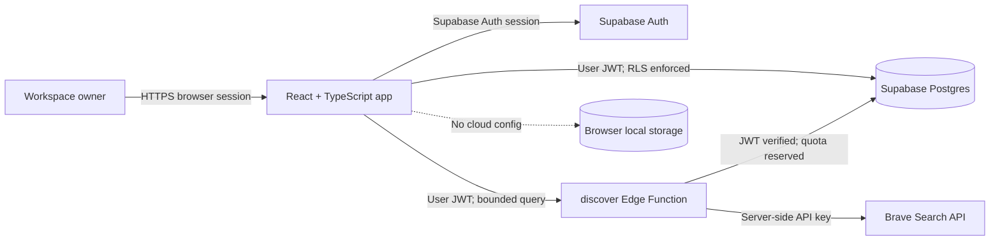
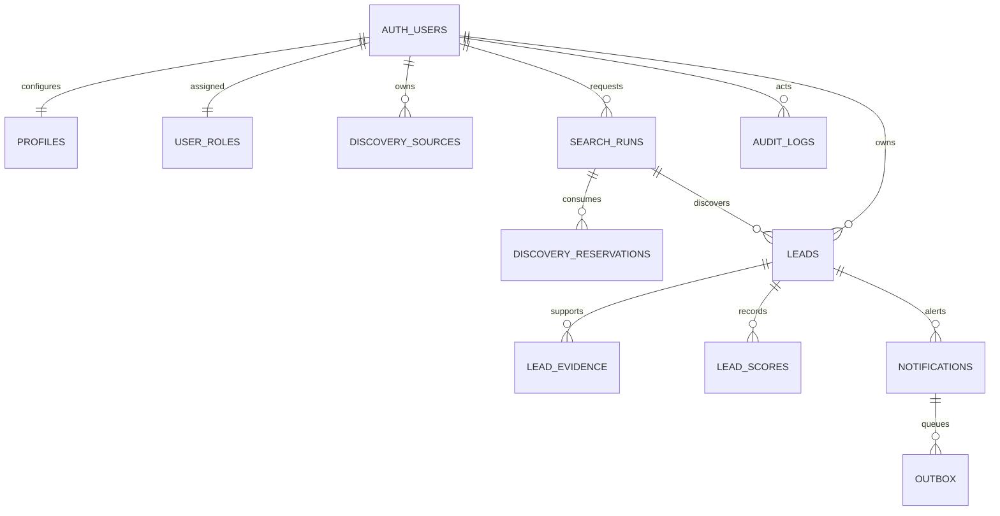

# Application architecture

This document describes the implementation on `ui-test`. External services remain opt-in until their owner, terms, limits, and environment configuration are approved.

## Runtime context and trust boundaries

The browser contains only the Supabase public URL and anon/publishable key. Provider credentials and any service-role credentials stay in managed server-side secrets. The discovery function checks the user session, validates request bounds, reserves a per-user monthly quota, filters returned URLs, and records run state. It does not fetch result pages or submit applications.

## Data model

All workspace reads and writes use owner-scoped RLS. Duplicate links must point to a canonical lead belonging to the same owner. Score snapshots are append-oriented and use a scoring version. Email outbox and audit tables are groundwork only; no email sender or audit event writer is deployed.

## Environments and secret handling

| Environment | Frontend config | Database | Provider credentials |
| --- | --- | --- | --- |
| Local, no Supabase config | None | Browser storage, synthetic sample records | None |
| Local cloud development | `.env.local`, ignored by Git | Supabase project selected by owner | Supabase Edge Function secrets only |
| Preview/production | Host-managed public Supabase URL/key | Separate Supabase environments recommended | Managed server secrets, never `VITE_*` |

The repository has no connected cloud project, hosting environment, or secret store configured. Use additive migrations through `supabase db push`; verify backup and rollback before production changes. Trusted Super Admin provisioning and recovery steps are documented in [OWNER_BOOTSTRAP.md](OWNER_BOOTSTRAP.md).

## Deferred boundaries

- Discovery is manual and Brave-only today. A source registry interface, scheduled job, independent-source retries, and admin source controls are not implemented.
- Research uses deterministic scoring and human evidence review. Page-fetching research and AI summaries are disabled.
- The email outbox is schema only. Provider selection, sender verification, retry worker, destination preferences, and delivery monitoring remain open.
- Admin roles and an `is_admin()` database helper exist, but no admin-facing controls or role-bootstrap operation are exposed to ordinary users.

Do not mark these integrations operational until deployment and acceptance checks are recorded in [IMPLEMENTATION_STATUS.md](../IMPLEMENTATION_STATUS.md).
