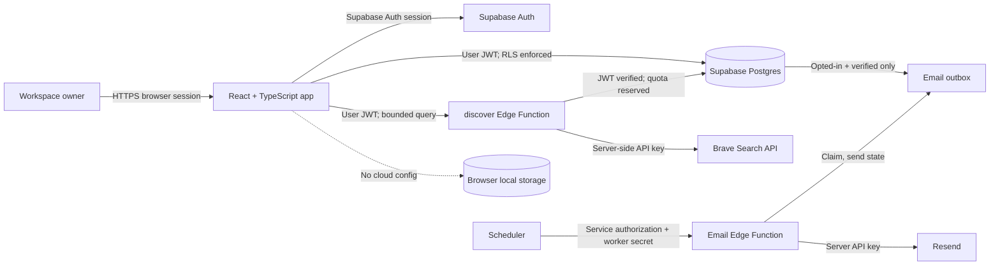
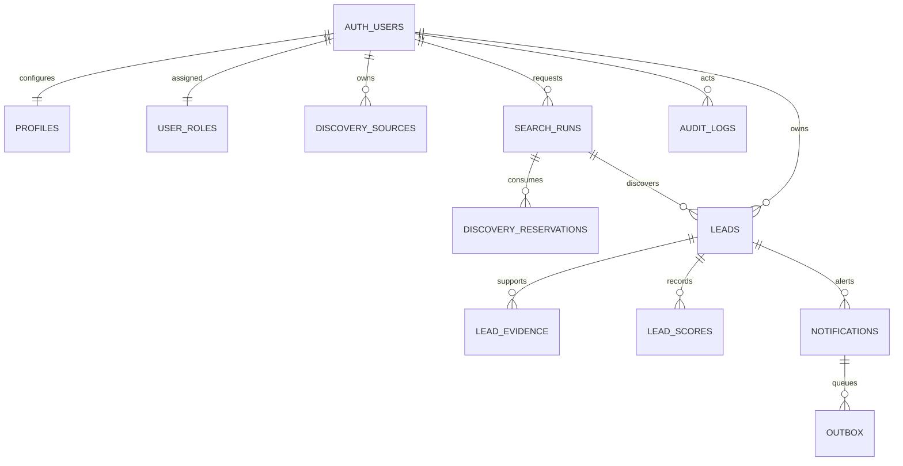

# Application architecture

This document describes the implementation on `ui-test`. External services remain opt-in until their owner, terms, limits, and environment configuration are approved.

## Runtime context and trust boundaries

The browser contains only the Supabase project URL and publishable key (or a legacy anon key). Secret/service-role credentials stay in managed server-side secrets. The discovery function checks the user session, requires owner terms and storage-rights consent plus a separate operator storage-rights flag, validates request bounds, reserves separate account and provider-wide monthly quotas through an atomic service-role-only RPC, filters returned URLs, and records source/run attribution. Removing the source deletes its stored result leads and linked evidence, scores, and notifications. It does not fetch result pages or submit applications. Migrations 007–009 add RLS-protected operational reads for admin roles, aggregate monthly usage, audited source pause/resume controls, an audited RPC to retry failed notification email, and serialized quota reservation; they do not grant ordinary users cross-account visibility.

## Data model

All workspace reads and writes use owner-scoped RLS. Duplicate links must point to a canonical lead belonging to the same owner. Leads record public contact availability as `unknown`, `public_channel`, or `not_found`; this records research progress without persisting contact details. Score snapshots are append-oriented and use a scoring version. A qualifying notification is always saved in-app; a database trigger separately queues email only when the owner opted in and their Auth email is verified. The outbox stores no recipient address. A server-only worker looks up the confirmed address, sends through Resend with a stable idempotency key, and records bounded retry/failure states. The worker and trigger are implemented but remain inactive until the migration, provider secrets, verified sender, and scheduler are configured. Audit event writers cover source pause/resume and notification retry; broader operational changes still need writers.

## Environments and secret handling

| Environment | Frontend config | Database | Provider credentials |
| --- | --- | --- | --- |
| Local, no Supabase config | None | Browser storage, synthetic sample records | None |
| Local cloud development | `.env.local`, ignored by Git | Supabase project selected by owner | Supabase Edge Function secrets only |
| Preview/production | Host-managed public Supabase URL/key | Separate Supabase environments recommended | Managed server secrets, never `VITE_*` |

The development project `pugvqkytxutnfucisurl` is linked through the Supabase CLI, and migrations 001–010 are applied with local and remote history aligned. Netlify hosts `https://jobsremyai.netlify.app`, but its current public bundle does not yet match the auth-enabled `ui-test` build; branch and build-environment alignment remains open. Use additive migrations through `supabase db push`; verify backup and rollback before production changes. Trusted Super Admin provisioning and recovery steps are documented in [OWNER_BOOTSTRAP.md](OWNER_BOOTSTRAP.md). The Admin screen is gated by the database role and adds no browser-held privileged credential. See [the design system](DESIGN_SYSTEM.md) and [ADRs](adr/) for implementation decisions and pending owner choices.

## Deferred boundaries

- Discovery runs only after an authenticated owner action and uses provider adapters for the Remote OK public job feed and Brave Search. Both server-side provider flags default off. Remote OK is opportunity-only; Brave company search remains gated on written storage rights. Owner source approval, caps, source-result deletion, admin pause/resume, and aggregate monthly usage reporting are implemented. Scheduled discovery and independent-source retries are not.
- Research uses deterministic scoring and human evidence review. Page-fetching research and AI summaries are disabled.
- Email provider choice is Resend in the worker implementation. Verify the sender domain, set `RESEND_API_KEY`, `EMAIL_FROM`, and a high-entropy `OUTBOX_WORKER_SECRET` as Edge Function secrets, deploy `dispatch-notification-email`, and configure a scheduler to call it with both the project service-role authorization and `x-worker-secret`. Keep every secret out of browser variables and Git. Confirm email delivery, retry behavior, queue age, and opt-out before enabling this channel for routine use.
- The outbox RPCs accept service-role calls only; authenticated users can read only their own outbox rows. The worker sends only to the current confirmed Auth address and never accepts an email destination from the browser.
- Admin roles and an `is_admin()` database helper back an Admin screen for recent source, run, email outbox, monthly aggregate usage, and audit data. Admins can pause/resume registered sources and retry failed email outbox items; each security-definer RPC checks the caller's admin role and records the action. Role bootstrap remains a trusted owner operation and is not exposed to ordinary users.

Do not mark these integrations operational until deployment and acceptance checks are recorded in [IMPLEMENTATION_STATUS.md](../IMPLEMENTATION_STATUS.md).
