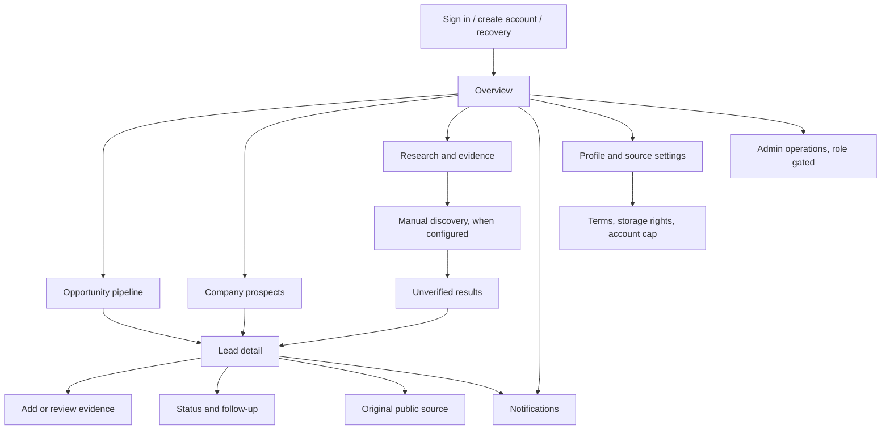

# UX flows and low-fidelity layouts

This document captures the screen structure implemented on `ui-test` and the intended path through the core journeys. It is a review artifact, not evidence of owner approval or a substitute for a browser walkthrough.

## Primary navigation



## Core journeys

### Sign-in and account recovery

1. Enter an email and password, or create an account.
2. New accounts receive a verification link; callback URLs must be allowed in Supabase Auth settings.
3. Sign-in loads the private cloud workspace only after its owner-scoped queries succeed.
4. A forgotten password sends an account-agnostic response and requests a callback to `/?auth=recovery`. Show the password-update form only after Supabase emits `PASSWORD_RECOVERY` with a valid session; an expired, reused, or unverified callback offers a fresh recovery request and cannot change a password.
5. Sign-out clears the session and returns to the account screen.

### First-time workspace setup

1. Open Settings and provide a headline, skills, services, target markets, portfolio links, and experience summary.
2. Set the notification threshold; email opt-in is unavailable until the Auth email is verified.
3. Keep discovery disabled until provider terms, pricing, and storage rights have been reviewed.
4. Add an opportunity or company manually if the owner has a public source URL, or create an unsourced private note.

### Review and follow up a lead

1. Open Opportunities or Companies; search and compose status, score, location, source, service, budget, contact-availability, recency, and unread filters.
2. Open a lead to see its original source, normalized summary, uncertainty, score components, evidence, and research gaps.
3. Record whether an appropriate public contact route was found. Do not put private contact details in this field.
4. Add a permitted public-page excerpt or an evidence observation; all extracted observations remain unverified until the owner reviews them.
5. Update status, notes, follow-up date, or duplicate link; export only the filtered records when needed.

### Discovery review

1. Start a manual search from Overview or Research.
2. Choose opportunity or company, market, and an editable query suggested from the profile.
3. The server checks Auth, source approval, provider enablement, storage-rights flags, and both account/global quotas.
4. Review returned snippets as unverified, deduplicate by canonical public URL, and save the resulting leads to the pipeline.
5. Review run status and source health in the workspace/Admin view.

### Notification review

1. Open Notifications from the main navigation or bell.
2. Open the linked lead, mark one or all alerts read, or dismiss an alert.
3. Email delivery is independent of the in-app record and remains opt-in, verified-address-only, and inactive until sender and scheduler setup is tested.

## Low-fidelity layout notes

### Desktop

```text
┌──────────────┬─────────────────────────────────────────────────────────────┐
│ Brand        │ Breadcrumb / mode / notifications / account                 │
│ Workspace    ├─────────────────────────────────────────────────────────────┤
│ Overview     │ Page title and primary action                                │
│ Opportunities│ Summary metrics                                              │
│ Companies    │ Search and filters                                           │
│ Research     │ Lead table with score, status, type, and added date           │
│ Notifications├─────────────────────────────────────────────────────────────┤
│ Settings     │ Recent activity / pipeline outcomes / source health          │
│ Admin*       │                                                             │
└──────────────┴─────────────────────────────────────────────────────────────┘
*Shown only for an account with an administrative database role.
```

### Phone

```text
┌──────────────────────────────┐
│ Menu  Page / mode       Bell  │
├──────────────────────────────┤
│ Page title                    │
│ Primary action                │
│ Summary cards (two columns)   │
│ Search (full width)           │
│ Filters (stacked)             │
│ Lead cards or scrollable table│
│ Outcome and source panels     │
└──────────────────────────────┘
```

Lead details and forms use a bounded, internally scrollable dialog. The side navigation slides over the page and closes after a route is chosen. Tables retain a readable minimum width inside their own scroll container rather than widening the whole page.

## Owner review checklist

- Confirm that Overview, Opportunities, Companies, Research, Notifications, Settings, and Admin are the right navigation groups.
- Walk through sign-in, recovery, manual intake, evidence review, discovery review, status/follow-up, and notification review.
- Review at phone, tablet, and desktop widths, including 200% zoom and the narrowest intended phone viewport.
- Check keyboard order, focus visibility, form labels, dialog behavior, status announcements, color contrast, and screen-reader names.
- Record owner feedback and any required changes in [IMPLEMENTATION_STATUS.md](../IMPLEMENTATION_STATUS.md).
